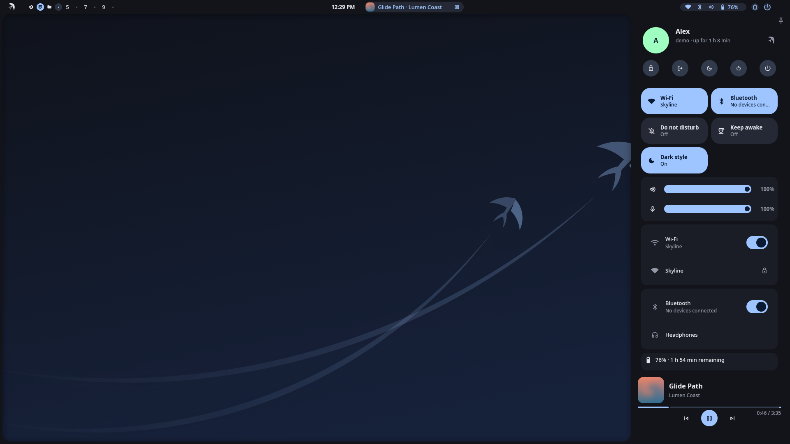
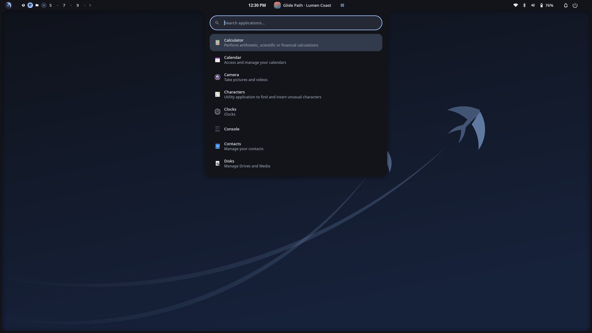
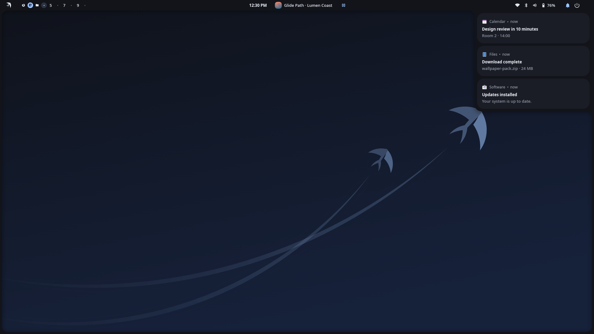
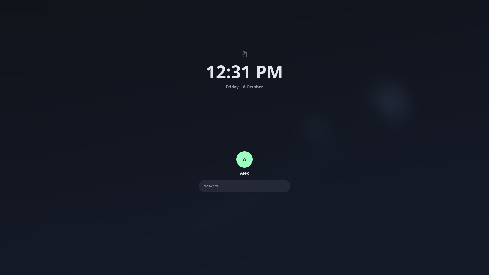
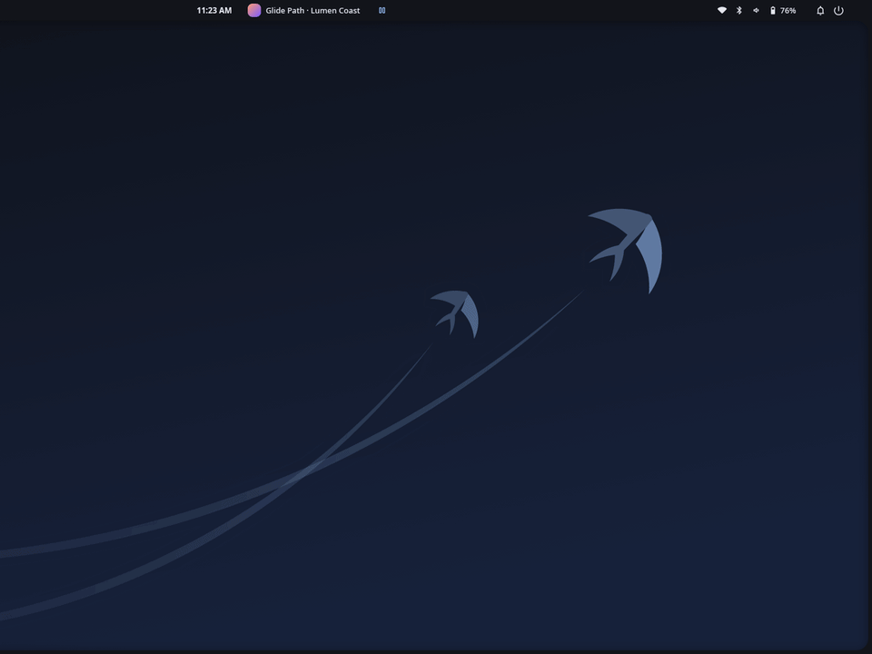
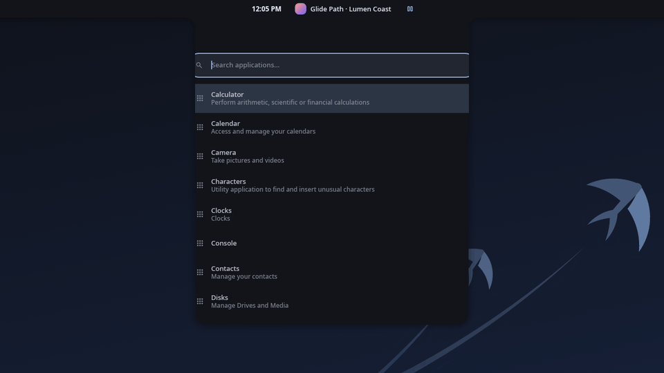
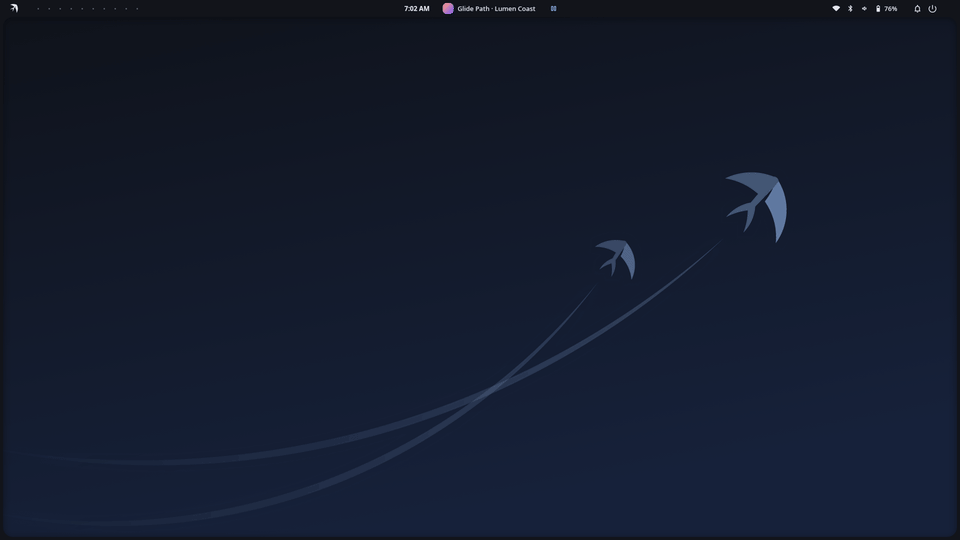

<p align="center">
  
</p>

<h1 align="center">Nuxut Shell</h1>

<p align="center"><em>The penguin can't fly. This one can.</em></p>

<p align="center">
A desktop shell for <a href="https://hyprland.org">Hyprland</a>, written entirely in Rust on top of its own UI
framework, <a href="https://github.com/nuxut/framework">nuxut/framework</a>.
</p>

<p align="center">
  
  
  
  
</p>

<p align="center">
  
</p>
<p align="center">
  
</p>

> **Status:** pre-release. Expect rough edges. Updates keep your settings.

## Features

- **Bar and edge panels** that grow out of the screen frame, per monitor, with a widget registry
  you arrange in `shell.toml` or from Settings.
- **Quick settings**: Wi-Fi, Bluetooth, audio output and per-app mixer, brightness, night light,
  power profiles, do-not-disturb.
- **Notifications** with history, **system tray**, **media controls** (MPRIS), volume and
  brightness OSD.
- **Launcher** with app search, calculator and emoji picker; **clipboard history**.
- **Lock screen** (`nuxut-lock`, PAM), idle handling and lock-before-sleep.
- **polkit authentication agent** (`nuxut-polkit`) and NetworkManager / BlueZ agents.
- **Screenshots**, a screen-share picker and an `xdg-desktop-portal` backend (file chooser,
  appearance settings).
- **Unified look**: one theme for the shell, GTK and Qt apps, cursors and icons, with undo.
- **Wallpapers** including video wallpapers; untrusted images are decoded in a sandboxed worker
  process.
- **Accessibility**: magnifier, on-screen keyboard, high contrast; screen-reader support (AT-SPI)
  is in progress.
- Turkish and English user interface.

<p align="center">
  
</p>

Companion apps: [Settings](https://github.com/nuxut/settings) ·
[Calendar service](https://github.com/nuxut/calendar) · [Accounts](https://github.com/nuxut/accounts)

## Install (Arch Linux + Hyprland)

```sh
curl -fsSL https://raw.githubusercontent.com/nuxut/shell/main/install.sh | sh
```

or, from a clone:

```sh
git clone https://github.com/nuxut/shell.git
sh shell/install.sh
```

The script:

- installs build dependencies and fonts with `pacman` (asks for `sudo` only for packages),
- clones framework, shell, settings and calendar into `~/.local/src/nuxut`,
- builds them and installs `nuxut-shell`, `nuxut-lock`, `nuxut-polkit`, `nuxut-settings`,
  `nuxut-calendard` and helpers into `~/.local/bin`, then checks that every binary is in place,
- installs the systemd user units,
- never edits your shell startup files (`~/.bashrc`, `~/.profile`, …),
- does not edit your Hyprland config itself: on first start the shell writes
  `~/.config/hypr/nuxut.lua` (or `nuxut.conf`) and adds a single include line, with a timestamped
  backup and an **Undo** action (`nuxut-shell msg hypr undo`; opt out with `--no-hyprland`).

The script never installs anything from the AUR. If you installed the `nuxut-git` package
(`dist/arch/PKGBUILD`), it detects it and asks you to update through your package manager.
To build a tag or commit instead of the tip of `main`, pass `--ref <tag>` (or set `NUXUT_REF`).

Run the script again to update. Updates keep your settings: on first start the shell migrates
old settings to the current format and repairs invalid or obsolete lines (with a backup first;
`nuxut-shell msg config status` shows what happened, `nuxut-shell msg config undo` reverts it).
The Welcome window only appears on a first install. `--reset-config` starts Nuxut as if freshly
installed (settings are moved to a backup). Uninstall with `sh install.sh --uninstall`; see
`sh install.sh --help` for all options. If another bar or notification daemon runs (dunst, mako,
swaync, waybar, quickshell, ags, eww), the script takes over: it records it, disables its systemd
unit (notification daemons are masked) and stops it for this session. `--uninstall` restores them,
`--keep-services` only warns. Hyprland `exec-once` lines are left alone; their locations are printed.

## Usage

- `nuxut-shell msg help` lists commands for the running shell (volume, brightness, panels, …).
- `nuxut-settings` opens Settings.
- Configuration lives in `~/.config/nuxut/shell.toml` and `framework.toml` and is applied live.

## Building from source

The repositories are built side by side (path dependencies):

```sh
mkdir nuxut && cd nuxut
for r in framework shell settings calendar; do git clone https://github.com/nuxut/$r.git; done
cd shell && cargo build --release
```

Architecture notes: [docs/ARCHITECTURE.md](docs/ARCHITECTURE.md) (Turkish).

## Contributing and security

See [CONTRIBUTING.md](CONTRIBUTING.md) and [SECURITY.md](SECURITY.md).

## License

[MIT](LICENSE) © 2026 Hakan Göksu

---

## Türkçe

Nuxut, Hyprland için tamamen Rust ile yazılmış bir masaüstü kabuğudur; kendi arayüz çerçevesi
[nuxut/framework](https://github.com/nuxut/framework) üzerine kuruludur. Bar ve kenarlardan
büyüyen paneller, hızlı ayarlar, bildirimler, sistem tepsisi, medya denetimi, başlatıcı, pano
geçmişi, kilit ekranı, polkit ajanı, ekran görüntüsü ve ekran paylaşım seçicisi, birleşik görünüm
(kabuk + GTK + Qt), video duvar kağıtları ve erişilebilirlik (büyüteç, ekran
klavyesi) içerir; ekran okuyucu desteği yolda. Arayüz Türkçe ve İngilizcedir.

**Kurulum (Arch Linux + Hyprland):**

```sh
curl -fsSL https://raw.githubusercontent.com/nuxut/shell/main/install.sh | sh
```

Güncellemek için betiği yeniden çalıştırın; güncelleme ayarlarınızı korur (eski biçimi kabuk
yedekleyip taşır; `nuxut-shell msg config undo` geri alır). Kaldırmak için `sh install.sh --uninstall`.
Ayarlar `~/.config/nuxut/shell.toml` ve `framework.toml` dosyalarındadır ve canlı uygulanır.
Lisans: MIT.
